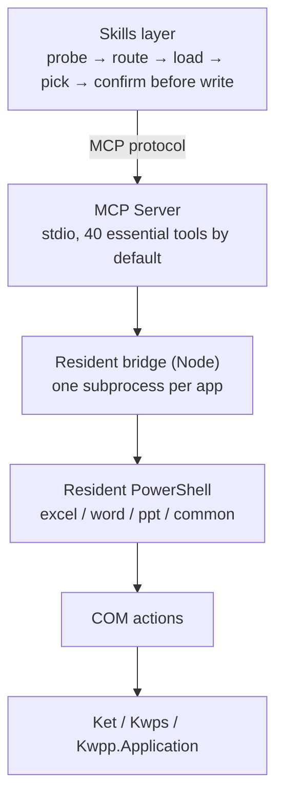

# WPS Office Multitool MCP

[简体中文](README.md) | **English**

<!-- AUTO:badges:start -->
[](https://github.com/forkgo430/wps-multitool-mcp/actions/workflows/ci.yml) [](LICENSE) [](https://www.npmjs.com/package/wps-multitool-mcp) [](https://github.com/forkgo430/wps-multitool-mcp/releases) [](#capabilities) [](#requirements)
<!-- AUTO:badges:end -->

> Let AI directly drive the WPS Office documents you have open right now — Writer, Spreadsheets, Presentation.
>
> It doesn't just edit: it creates from scratch. A blank page becomes a report with a table of contents and charts;
> spreadsheet numbers become charts and pivot tables, then land in a slide deck; fonts and themes swap across the
> whole file; everything exports to images and PDF.

| | Read | Write | Create | Format | Export |
|---|:--:|:--:|:--:|:--:|:--:|
| WPS Writer | ✓ | ✓ | ✓ | ✓ | ✓ |
| WPS Spreadsheets | ✓ | ✓ | ✓ | ✓ | ✓ |
| WPS Presentation | ✓ | ✓ | ✓ | ✓ | ✓ |

<sub>Author / maintainer: **Yingrong** · [npm](https://www.npmjs.com/package/wps-multitool-mcp) · [Releases](https://github.com/forkgo430/wps-multitool-mcp/releases)</sub>

## Quick start (30 seconds)

```powershell
npx -y wps-multitool-mcp
```

```json
{
  "mcpServers": {
    "wps-multitool-mcp": {
      "command": "npx",
      "args": ["-y", "wps-multitool-mcp"]
    }
  }
}
```

Restart your MCP client, open a WPS document, and just say:

> Bold the amount section of this contract and add a risk note at the end

More examples:

- "Turn this sheet into a bar chart and export it as an image"
- "Unify the whole deck to Source Han Sans and add page numbers"
- "Generate a table of contents and cross-references for this paper"

Want a side panel (snapshot / undo / status) inside WPS? Install the add-in:

```powershell
irm https://cdn.jsdelivr.net/gh/forkgo430/wps-multitool-mcp@main/scripts/install.ps1 | iex
```

> Security-minded? Download the script first, verify it with `Get-FileHash` against the SHA256
> published on the Releases page, then run; swap `@main` for `@v1.0.3` to pin a version.

## What it does

| Capability | How |
|---|---|
| A finished document from a blank page | Create, add slides, write titles and body, apply themes, add animations and transitions, page numbers — one chain |
| Turn spreadsheet numbers into report material | Build charts or pivot tables from the sheet, export as images, drop them into a presentation |
| Structural slide elements | Timelines, flowcharts, org charts, gauges, donut charts, progress bars, KPI cards, mini charts, styled tables — all first-class tools |
| Unified look across the file | `beautify_all_slides` applies one style, `unify_font` unifies fonts, `auto_layout` and `smart_distribute` arrange everything |
| Official-document & academic formatting | Auto TOC, bibliography, cross-references, footnotes, tracked revisions, headers/footers, template field filling |
| Formulas, beyond writing them | Generate formulas and diagnose why one fails. Array formulas; pivot tables fully supported |
| Export | Slides as images, charts and ranges as images, format conversion, PDF |
| Batch execution with snapshots | `wps_common_batch` runs multiple steps; destructive steps snapshot first, so you can roll back |

Four conveniences built in:

- **One sentence routes the work**: `wps_route_intent` maps "make me a report" to the presentation group — and says so when it can't
- **Search tools in Chinese**: `wps_search_tools` results carry `notFor` counter-examples to separate near-named tools
- **Every tool carries safety labels**: all 287 marked read-only / destructive / idempotent
- **Renames don't break old calls**: old names auto-resolve, parameters migrate with them

<!-- AUTO:tool-table:start -->
| App | Tools | Highlights |
|-----|-------|-----------|
| Excel | 91 | formulas, data, charts, pivot tables, sheets, formatting, workbooks, rows/columns, comments & protection, image export |
| Word | 69 | formatting, content, document management, headers/footers, comments, bookmarks, tables, templates, academic layout, revisions, index, cross-references |
| PPT | 102 | slides, shapes, images, tables, beautify, animations, charts, 3D, data viz, image export |
| Common | 26 | save, connection check, text selection, format conversion, tool groups, intent routing, batch |
| Built-in | 7 (already counted above) | connection check, generic method, data cache |
<!-- AUTO:tool-table:end -->

The full list of all 287 tools (name / confirmation level / real-machine verification status) lives in
**[TOOLS.md](TOOLS.md)**, generated from the registry. Old tool names keep working — they auto-resolve
to the new tools with parameters migrated.

<details>
<summary><b>Scale (measured from the registry)</b></summary>

<!-- AUTO:tool-stats:start -->
- **288 tools** (7 built-in + 281 specialized); **only 40 listed by default** (essential ∩ live-verified, load on demand — see `scripts/manual/basic-tier-verify.js`)
- Distribution (by tool group, built-ins counted in their app group): Common 26 (incl. core) / Word 69 / Excel 91 / PPT 102
- Annotations (measured): read-only 51 / destructive 36 / non-idempotent 111 — coverage 287/288
<!-- AUTO:tool-stats:end -->

</details>

## Install

<details>
<summary><b>Requirements</b></summary>

| Requirement | Notes |
|------|------|
| Windows 10 / 11 | WPS COM automation is Windows-only |
| WPS Office 2019+ (tested on 12.1) | Any install drive |
| Node.js ≥ 18 | Build & run the MCP server |
| An MCP client | Claude Code / Cursor / Codex CLI / CodeBuddy / WorkBuddy / DeepSeek Harness (dsh) etc. |

</details>

<details>
<summary><b>One-command install (MCP + add-in + skill)</b></summary>

```powershell
irm https://cdn.jsdelivr.net/gh/forkgo430/wps-multitool-mcp@main/scripts/install.ps1 | iex
```

Checks the environment, pulls the project, installs and builds, deploys the WPS add-in, installs the
skill, and prints your MCP config. Requires GitHub access; otherwise install manually below.

</details>

<details>
<summary><b>Manual install</b></summary>

```bash
git clone https://github.com/forkgo430/wps-multitool-mcp.git
cd wps-multitool-mcp
powershell -ExecutionPolicy Bypass -File scripts/install.ps1
```

</details>

<details>
<summary><b>Auto-configure MCP clients</b></summary>

```powershell
node wps-multitool-mcp/dist/index.js install
```

Recognizes **CodeBuddy / WorkBuddy / Codex CLI / Claude Code / Cursor**, writing each client's native
format, plus dedicated **DeepSeek Harness** support. Only touches clients that are already installed;
backs up before writing, reads back after, restores on failure. `--dry-run` for a rehearsal,
`--print` to print without writing.

</details>

## How it works



Cold start is about 5 seconds; after that each call is a 2–3 ms bridge round-trip
(not counting the actual WPS action itself). One process per app: if Writer hangs,
Spreadsheets keeps working.

## Safe to let AI loose

AI makes mistakes, so every layer assumes it will:

| Guard | What you get |
|---|---|
| **Auto-snapshot before writes** | Destructive / non-idempotent writes snapshot first, with an operation log — roll back to the on-disk version |
| **Safety labels on every tool** | Read-only / destructive / repeatable, readable straight from `tools/list` so clients can ask you first |
| **Failures say whether to retry** | `[retry]` resend freely; `[do-not-retry · may have half-executed]` read back before deciding |
| **Real-machine verification ledger** | Every tool is marked with its verification status (see [TOOLS.md](TOOLS.md)); the default list only includes verified ones |
| **Multi-target pinning** | In multi-document tasks, tools explicitly address "which document" instead of following window focus |

## Side panel

`wps-multitool-addon/` is a task pane installed into WPS: a sidebar showing live bridge status plus
**Save / Undo / Export PDF / Snapshot / Unstick** action buttons — note it really changes documents;
only the status endpoint is read-only. Installing or not installing it doesn't affect MCP; both share
the same bridge.

## Using it in DeepSeek Harness (dsh)

**One command installs tools and skill together**:

```sh
dsh plugin --profile <your-profile> add dsh-multitool
```

You get 40 WPS tools plus a skill teaching AI the correct order of use. Tool prefix: `mcp__wpslocal__*`.

> ⚠️ Don't confuse packages: npm also has `dsh-wps`, a Kingsoft **cloud-document** integration. This
> package drives the WPS windows open on your computer — no network, no OAuth. Both can coexist.

## Privacy

- **Document content never leaves your machine**: no telemetry, no crash reporting, no usage stats — `src/` makes zero outbound requests
- The only local network endpoint is the bridge's read-only status API (`127.0.0.1:27731/status`, for the WPS task pane)
- Snapshots stay in `~/.wps-multitool-mcp/snapshots/` and are document copies; clear them after handling sensitive files

Full threat model in [SECURITY.md](SECURITY.md).

## Known limitations

- **Windows only**: WPS COM automation doesn't exist elsewhere (Linux is under construction — see roadmap below)
- **WPS must be open**: it drives live documents, not a file converter
- **COM writes are not transactions**: no Ctrl+Z when something goes wrong — which is why snapshots are on by default
- **40 tools by default**: the rest load by group, so hundreds of tools don't flood the AI's context
- Some tools haven't been verified on a real machine yet (marked `static` in the list) — tell your user honestly after using them

## Troubleshooting

| Problem | Fix |
|------|---------|
| MCP connection fails | Check `dist/index.js` exists and the client path is right |
| WPS not responding | Restart WPS; confirm `%APPDATA%\kingsoft\wps\jsaddons\wps-claude-addon_` exists |
| "arguments error" | Re-run `scripts/install.ps1`, restart WPS |
| One-command install hangs | No GitHub access — use manual install |
| Anything else | [Open an issue](https://github.com/forkgo430/wps-multitool-mcp/issues) |

## Roadmap

- **Linux / macOS**: platform auto-detection and the add-in channel skeleton have landed; full WPS JSAPI
  coverage has been measured (296 actions: 199 supported / 45 adaptable); the action layer is being implemented.
  See `docs/agents/linux/`.
- More batch scenarios and checks are on the way — [tell us](https://github.com/forkgo430/wps-multitool-mcp/issues) which workflow you want.

## License

MIT
