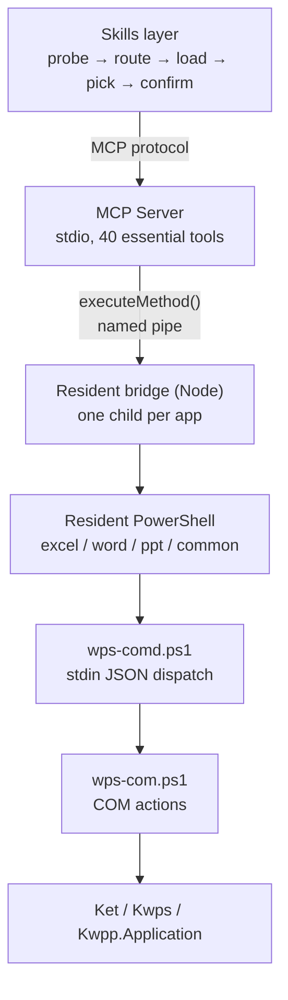

# WPS Office Multitool MCP

[简体中文](README.md) | **English**

<!-- AUTO:badges:start -->
[](https://github.com/forkgo430/wps-multitool-mcp/actions/workflows/ci.yml) [](LICENSE) [](https://www.npmjs.com/package/wps-multitool-mcp) [](https://github.com/forkgo430/wps-multitool-mcp/releases) [](#capabilities) [](#requirements)
<!-- AUTO:badges:end -->

> Let AI drive the WPS Office windows you already have open.
>
> It doesn't only edit. It builds. A document with a table of contents and charts, starting from a
> blank page. Numbers in a spreadsheet turned into charts and pivot tables, then dropped into a deck.
> A whole presentation restyled. Everything exported to images and PDF.
>
> **Every requirement, the whole stack.** Three apps, five stages, and every cell has a tool behind
> it. For anything not wrapped as a tool, `wps_execute_method` reaches all 306 low-level actions.

| | Read | Write | Generate | Layout | Export |
|---|:--:|:--:|:--:|:--:|:--:|
| WPS Writer | ✓ | ✓ | ✓ | ✓ | ✓ |
| WPS Spreadsheets | ✓ | ✓ | ✓ | ✓ | ✓ |
| WPS Presentation | ✓ | ✓ | ✓ | ✓ | ✓ |

<sub>Author & maintainer: **赢容** · [npm](https://www.npmjs.com/package/wps-multitool-mcp) · [Release](https://github.com/forkgo430/wps-multitool-mcp/releases)</sub>

## 30-second setup

```powershell
npx -y wps-multitool-mcp
```

```json
{
  "mcpServers": {
    "wps-multitool-mcp": {
      "command": "npx",
      "args": ["-y", "wps-multitool-mcp"]
    }
  }
}
```

Restart your client, open a WPS document, then just ask:

> Bold the payment clause and append a risk note at the end

Want the in-WPS panel (snapshots / undo / status)? Install the add-in:

```powershell
irm https://cdn.jsdelivr.net/gh/forkgo430/wps-multitool-mcp@main/scripts/install.ps1 | iex
```

<a id="capabilities"></a>

## What it can do

| What you get | How |
|---|---|
| A finished document from a blank page | Create the file, add pages, write titles and body, apply a theme, add animations and transitions, add page numbers. One chain, no tool switching |
| Spreadsheet numbers turned into a report | Build charts or pivot tables straight off the data, export them as images, drop them into the deck. The copy-paste step is gone |
| Presentation building blocks | Timelines, flow charts, org charts, gauges, donut charts, progress bars, KPI cards, mini charts, 3D text, styled tables. Each is a tool, not a pile of shapes you position by hand |
| Whole-deck consistency | `beautify_all_slides` applies one style across the deck, `unify_font` sets one font everywhere, `auto_layout` arranges, `smart_distribute` evens out spacing |
| Chinese document and academic layout | Table of contents, bibliography index, cross-references, footnotes, tracked changes, headers and footers, template field filling |
| Formulas that go past writing | Generate a formula, and diagnose why one errors. Array formulas, and pivot tables with create / refresh / update / query / clear |
| Export | Slide images, chart and range images, format conversion, PDF |
| Batch runs with a safety net | `wps_common_batch` runs several steps at once, snapshots before any destructive step, and can roll back to the on-disk version afterwards |

Four more that make daily use smoother:

| Feature | Detail |
|---|---|
| Route in one sentence | `wps_route_intent` maps "make me a deck" to the presentation group. When it can't tell, it says so and asks you to rephrase instead of picking something at random |
| Search tools in Chinese | `wps_search_tools` takes plain Chinese keywords, and results carry `notFor` counter-examples. Six `background` tools and five `animation` tools are told apart by that, not by name |
| Safety labels on every tool | All 284 carry `readOnly` / `destructive` / `idempotent`. The model can see which one deletes content and which one is safe to repeat |
| Renames don't break old calls | Aliases carry parameter mappings. After a tool is renamed the old name still works, and its parameters move to the new fields automatically |

<!-- AUTO:tool-table:start -->
| App | Tools | Highlights |
|-----|-------|-----------|
| Excel | 89 | formulas, data, charts, pivot tables, sheets, formatting, workbooks, rows/columns, comments & protection, image export |
| Word | 67 | formatting, content, document management, headers/footers, comments, bookmarks, tables, templates, academic layout, revisions, index, cross-references |
| PPT | 101 | slides, shapes, images, tables, beautify, animations, charts, 3D, data viz, image export |
| Common | 27 | save, connection check, text selection, format conversion, tool groups, intent routing, batch |
| Built-in | 8 (already counted above) | connection check, generic method, data cache |
<!-- AUTO:tool-table:end -->

Counts are generated from the live registry by `scripts/manual/gen-doc-stats.js` — do not edit by
hand (CI enforces a diff gate). Same scope as the stats block below: built-in tools are counted
inside their app group (core inside Common), so the "Built-in" row is not additive.

The full list of all 284 tools (name / default tier / annotations / live-verification status) is in
**[TOOLS.md](TOOLS.md)** — generated from the registry, so it can never drift from the code.
Another 31 old-name aliases resolve to their current tools at call time.

## Architecture



Cold start runs about 5 seconds, bringing up the resident bridge and four resident PowerShell
processes. After that each call costs 2 to 3 ms. MCP talks to WPS over a named pipe: no HTTP
polling, and no new script process per call. Twenty format edits in a row cost twenty times two
milliseconds.

One process per app. If Writer wedges, Spreadsheets keeps working.

Most guards live in exactly one place:

| Guard | Where | What it buys |
|---|---|---|
| Action exit | `src/client/wps-client.ts:248` `execWpsAction` | All 306 COM actions pass through this one function; nothing else talks to PowerShell directly |
| Snapshot, warnings, cancellation, error tags | `tool-registry.ts:596`, `wps-client.ts:35`, `mcp-server.ts:158`, `mcp-server.ts:206` | Those four identifiers appear **0 times** under `src/tools/**`. Going from 284 tools to 500 won't miss one |
| Cancellation signal | `mcp-server.ts:158` (`AsyncLocalStorage`) | Never enters any tool's parameter schema. Adding cancellation touched **zero** of the 284 tools |
| Fallback retry | `wps-client.ts:261` | Only when the request was never sent. Timeouts are re-thrown as-is instead of guessed at |

Transports are pluggable: `pickTransport` picks one, `runTransport` runs it (`wps-client.ts:79` /
`:223`). Adding a third channel later, say the Linux add-in JSAPI, leaves both Windows paths alone.

The side panel and the MCP server share one bridge. Installing the panel doesn't affect MCP;
skipping it doesn't either.

## Who it's for

You work in WPS on Windows and you want to edit the document that is already open.

- Writer, Spreadsheets and Presentation are your daily drivers: contracts, papers, reports, decks
- The target is the file in front of you, comments and tracked changes and headers and unsaved edits included
- You need the Chinese-language details: table of contents and cross-references, bibliography index, tracked revisions, template field filling
- You want the AI to take a snapshot before it writes

All 284 tools are built against WPS's COM model (`Ket` / `Kwps` / `Kwpp`). The Chinese document
conventions, revision tracking and academic layout are tuned for how WPS users actually work.
For MS Office there are dedicated servers in the community; use whichever fits.

> The cross-platform route goes through the WPS add-in JSAPI. The design is finished; what's
> missing is a public source on how to install and enable add-ins on Linux. The design document is
> `docs/agents/PLAN-LINUX-BACKEND.md`, kept alongside the project but not committed.

## Six mechanisms that hold it up

Many tools, heavy documents, tangled actions — when an AI starts working, it tends to slip in three
places: picking the wrong tool, editing the wrong spot, and having no way back. These six are built
for that.

| Situation | Mechanism |
|---|---|
| Hundreds of tools crowd the context | Only the essential tier is listed. The rest are searched and loaded on demand, then released |
| The write finished, but nobody can say how many places changed | `warnings` as a third state: the main task landed, side effects are recorded separately, each traceable |
| Two tools differ by a single word | Every tool carries a `notFor` counter-example. Read it before choosing |
| Getting back to before the edit | An automatic snapshot before risky writes, paired with an operation log, restores the on-disk version |
| Not knowing which tools have actually run | Every tool carries its real-machine verification status; the default tier lists only verified ones |

COM is not transactional, so failures carry a retry tag: `[retryable]` resend freely,
`[do-not-retry · possibly half-applied]` read back first.

## How it gets things right

The previous section lists what each mechanism solves. This one is about where those mechanisms are
attached. Whether a problem is really prevented depends on whether the guard lives in 284 separate
files or on a single choke point.

Every row below cites `file:line` so you can check it yourself. Line numbers match the current HEAD.

| Mechanism | Where it lives | Why it's worth calling out |
|---|---|---|
| **One exit for every action** | `wps-multitool-mcp/src/client/wps-client.ts:248` `execWpsAction` | All 306 COM actions (`src/client/action-routes.generated.ts:6`) go through this one function; nothing else talks to PowerShell directly |
| **Guards don't live inside tools** | snapshot `src/server/tool-registry.ts:596`; warnings extraction `src/client/wps-client.ts:35`; cancellation `src/server/mcp-server.ts:158`; error tags `src/server/mcp-server.ts:206` | Not one line of guard logic in the 284 handlers — those four identifiers appear **0 times** under `src/tools/**`. Four edits cover every tool, now and if the count doubles |
| **Cancellation needs no tool signature changes** | `src/server/mcp-server.ts:158` (AsyncLocalStorage) | The cancel signal travels through context into the depth of the call chain, never into any tool's parameter schema. Adding cancellation touched **zero** of the 284 tools |
| **Exactly one fallback path, and only for "never sent"** | `src/client/wps-client.ts:261-268` | Falling back to a direct run happens only when the bridge can't start. Timeout-class errors are **re-thrown as-is, never auto-retried** — the request may already have half-executed inside WPS, and a replay would execute it twice |
| **One risk criterion for the whole project** | `src/bridge/cancellable.ts:123`, shared with `src/tools/common/batch.ts:38` | Batch and single calls must agree on "is this action destructive". The code comment says it outright: "口径不一致会让人以为单调用也安全" (inconsistent criteria make people think a single call is safe) |
| **Verification status has exactly two states** | `wps-multitool-mcp/scripts/manual/tool-verification.json:3` (single source of truth; `:5` forbids a third state) | There is no "basically works" tier — a third state always ends up being read as "good enough". The default tier only lists `live` (`src/server/tool-registry.ts:244`) |
| **Docs must match the ledger** | `wps-multitool-mcp/scripts/manual/skill-content-truth.js:44,136`, gated at `skill-verify.js:131` | If a doc written for AI claims a verification status that contradicts the ledger, the gate goes red. This rule exists because of a real incident: the docs long claimed PPT was unverified while isolated verification had long been green |
| **Aliases can carry parameter mappings** | `wps-multitool-mcp/scripts/manual/tool-aliases.json:42`, applied at `src/server/tool-registry.ts:586` **before** required-argument validation | When tool families are merged, old parameter names (`preset` → `effect`) are carried along. Renaming without carrying them makes old calls either fail for a missing argument or, worse, **silently ignored and applied with defaults** |

## Scale

<!-- AUTO:tool-stats:start -->
- **284 tools** (8 built-in + 276 specialized); **only 40 listed by default** (essential ∩ live-verified, load on demand — see `scripts/manual/basic-tier-verify.js`)
- Distribution (by tool group, built-ins counted in their app group): Common 27 (incl. core) / Word 67 / Excel 89 / PPT 101
- Annotations (measured): read-only 51 / destructive 35 / non-idempotent 108 — coverage 284/284
<!-- AUTO:tool-stats:end -->

<a id="requirements"></a>

## Install

<details>
<summary><b>Requirements</b></summary>

| Requirement | Notes |
|-------------|-------|
| Windows 10 / 11 | WPS COM automation is Windows-only |
| WPS Office 2019+ (tested 12.1) | Any drive |
| Node.js ≥ 18 | Build and run the server |
| An MCP client | Claude Code / Cursor / Codex CLI / CodeBuddy / WorkBuddy / DeepSeek Harness (dsh), etc. |

</details>

<details>
<summary><b>Full install (one-liner + add-in + skill)</b></summary>

```powershell
irm https://cdn.jsdelivr.net/gh/forkgo430/wps-multitool-mcp@main/scripts/install.ps1 | iex
```

Checks the environment → fetches the project → installs deps and builds → deploys the WPS add-in →
installs the skill → prints the MCP config. Restart WPS and your client afterwards.
Needs GitHub access; otherwise use the manual install.

</details>

<details>
<summary><b>Manual install</b></summary>

```bash
git clone https://github.com/forkgo430/wps-multitool-mcp.git
cd wps-multitool-mcp
powershell -ExecutionPolicy Bypass -File scripts/install.ps1
```

The script also takes `-DryRun` (check only), `-Dev` (symlink the add-in so source edits apply live),
and `-InstallDir`.

</details>

<details>
<summary><b>One-command setup: writes your MCP config for you</b></summary>

Don't hand-copy paths — let the program write them:

```powershell
node wps-multitool-mcp/dist/index.js install
```

**What it does**: writes this MCP server's launch entry into each client's config file — one
command, no hunting for paths, no hand-copying JSON. Standard stdio server (spec 2025-11-25).

**It knows these five clients** (each in its own native format, not one generic template):

| Client | File it writes | Format |
|---|---|---|
| CodeBuddy | `~/.codebuddy/mcp.json` | JSON |
| WorkBuddy | `~/.workbuddy/mcp.json` | JSON |
| Codex CLI | `~/.codex/config.toml` | TOML |
| Claude Code | `~/.claude.json` (or `~/.claude/settings.json`) | JSON |
| Cursor | `~/.cursor/mcp.json` | JSON |

**It only touches clients you already have** — detected by the config file existing, or that
client's own directory existing. It won't create a directory out of thin air. (There's a trap
here: the parent directory of `~/.claude.json` *is* your home directory and always exists, so a
directory-only check would create a `.claude.json` on every machine.)
For clients it can't detect, it prints a ready-to-paste snippet.

**DeepSeek Harness (dsh) has two routes; the first is recommended**:

```powershell
# 1) Install the bundle: tools + skill in one go (recommended)
dsh plugin --profile <your-profile> add dsh-multitool

# 2) Or just generate a config snippet and merge it yourself
node wps-multitool-mcp/dist/index.js install --client dsh
```

The second route generates `~/.dsh/wps.cordis.yml`; then either `dsh web --patch <that file>` for a
one-off run, or merge its `insert` block into `$DSH_HOME/profiles/<profile>/cordis.patch.yml`
(append, never overwrite).

**Why route 2 is not auto-written like the others**: dsh config is a YAML *patch layer* — writing means
appending one entry to an `insert` list that already holds somebody else's patches. String-splicing YAML
into a file we don't own can kill a user's entire plugin config once. A separate file plus a deliberate
merge step is the safer trade.

> Route 1 (the bundle) sidesteps that concern entirely: `dsh plugin` writes into
> `dsh.profile.bundles` through the official mechanism and never touches the user's `cordis.patch.yml`.

**Three safety properties**:

| Property | What it does |
|---|---|
| **Backs up before writing** | Every config it will touch gets a `.bak-<timestamp>` copy in the same directory |
| **Reads back after writing** | Writes, then **reads the file back and validates it** — JSON must parse and contain our entry under `mcpServers`; TOML must read back its header. **Writing isn't success; being able to read it back is** |
| **Restores on failure** | If the read-back check fails, it immediately restores from that backup and returns an error, rather than leaving you a broken config |

Two switches:

```powershell
node dist/index.js install --dry-run    # rehearse: reports which files it would touch, writes nothing
node dist/index.js install --print      # prints config snippets only, touches nothing
```

Actual `--print` output (it **only lists clients installed on this machine**; undetected ones are
never written to disk, only printed as a snippet):

```
wps-multitool-mcp install
启动项：node C:\Users\金东权\wps-skills\wps-multitool-mcp\dist\index.js

# CodeBuddy — C:\Users\金东权\.codebuddy\mcp.json
{
  "mcpServers": {
    "wps-multitool-mcp": {
      "command": "node",
      "args": [
        "C:\\Users\\金东权\\wps-skills\\wps-multitool-mcp\\dist\\index.js"
      ]
    }
  }
}

# WorkBuddy — C:\Users\金东权\.workbuddy\mcp.json
{ ... same shape ... }
```

</details>

## Side panel: the one that lives inside WPS

Besides MCP, there's a **GUI** route: `wps-multitool-addon/` — a WPS **task pane** that loads
into the sidebar. Pure-CLI tools usually have no such layer.

**What it is**: a WPS add-in (`manifest.xml` + `ribbon.xml` + a task pane page). The ribbon has
9 buttons in 4 groups; the sidebar panel re-reads bridge status every 2 seconds.

**What it does — status view, plus five action buttons**:

| What the panel shows | Where it comes from |
|---|---|
| Whether the bridge is up, how many apps are online | The bridge's read-only status endpoint, `http://127.0.0.1:27731/status` |
| Whether there's an active document | Same |
| Recent calls | Summaries the bridge records on the named pipe (**no document body**) |

⚠️ **The panel is NOT read-only**: it has **Save / Undo / Export PDF / Snapshot / Unstick**
buttons that change document state directly, and its manifest requests write access
(`document.write`). **Only the status endpoint above is read-only.** The main document-editing
tools remain on the MCP server side. The "basic tier, 40 tools" text in the panel is hard-coded
copy (the bridge can't reach the MCP server's registry).

**It shares the same bridge as the MCP server.** That's why the two don't fight: both entry
points connect to the same named pipe with the same credentials, in any order.
**Installing the panel doesn't affect MCP, and not installing it doesn't either** —
they aren't primary/standby, they're two ways to work side by side.

> The task pane runs inside an embedded browser and can't reach a named pipe (a kernel object,
> visible only within the owning process), so the bridge also opens a **read-only** localhost
> HTTP endpoint for the panel alone.

**The deployed directory is named `wps-claude-addon_` and was deliberately not renamed** with
the repo. The add-in directory inside the repo *was* renamed, but the one under
`%APPDATA%\kingsoft\wps\jsaddons\` was **intentionally left alone**, so existing users notice
nothing: nothing to reinstall, no config to change, nothing to read up on.
(Decisions like "should a rename accommodate existing users" read as oversights, so it's
written down here.)

<details>
<summary><b>Deploying the add-in by hand</b></summary>

```powershell
powershell -ExecutionPolicy Bypass -File scripts\deploy-addon.ps1          # deploy
powershell -ExecutionPolicy Bypass -File scripts\deploy-addon.ps1 -Check   # show differences only
```

The deploy script uses **Copy-Item, not a symlink** (symlinks need admin rights; it falls back
to copying), so the target directory is a **copy** — editing the repo without redeploying leaves
WPS showing the old contents no matter how many times you restart it.
You must **fully quit WPS and reopen it** afterwards (right-click the taskbar icon and exit,
not just close the window).

</details>

## Skill package: how an AI learns to use it

`wps-multitool-mcp/skills/wps-multitool/` is one SKILL.md plus 3 reference files, read by an
AI. **It is not the same thing as "give me JSON and generate a PPT"** — it doesn't describe
capabilities, it prescribes an **order**.

**Why that distinction matters**: a capability list goes stale (change one tool, the list is
wrong), but an **order doesn't**. So this skill **deliberately lists no tools**; it only teaches
how to find, how to choose, and how to confirm. The list is left to the runtime
(`tools/list` / `wps_search_tools`); the skill only owns the chain.
**So it doesn't go stale when the next version adds tools.**

**The five-step chain**:

| Step | One line | What it solves |
|---|---|---|
| **1. Probe** | `wps_common_status` first — is the bridge up, is WPS running, is there an active document | Skip this and every later step may be wasted work |
| **2. Pick the group** | `wps_route_intent` maps the request to word / excel / ppt / common | 284 tools are unfindable ungrouped; when the wording is vague it tells you not to guess |
| **3. Load the group** | Only 40 basic tools are listed by default; the rest need `wps_load_tool_group` | **"That tool doesn't exist" usually means the group isn't loaded**, not that the capability is missing |
| **4. Choose** | `wps_search_tools` takes plain Chinese keywords, but **`notFor` in the results must be read** | This MCP has many near-identical names (6 × `background`, 5 × `animation`) that you can't tell apart by name. Choosing wrong raises nothing — it just changes the wrong thing |
| **5. Confirm before writing** | Lock onto the target document first, then snapshot | COM writes are **not transactional — there's no undo**; you may have several documents open, and one window switch writes to the wrong file |

**Three red lines** (each exists because something was hit for real):

- **Never replay a `no-retry` error verbatim** — the returned prefix already says whether a retry
  is safe. Timeouts and COM errors are in the "may have half-executed" class; replaying blindly
  writes the same content twice and stacks styles three deep.
- **Confirm destructive tools with the user first** — every tool in `tools/list` carries
  `annotations`; the ones with `destructiveHint: true` delete content, drop unsaved edits, or
  convert formats in place.
- **`static` does not mean "unusable"** — it means "nobody has verified this one on a real
  machine". If you use one, tell the user so honestly ("this tool has only static checks"),
  and **don't treat 'it didn't error' as 'it did the right thing'**.

> One gate in the repo watches this skill specifically: `scripts/manual/skill-verify.js`
> (**30 assertions**). It reconciles every "group + verification conclusion" in the docs against
> the `tool-verification.json` ledger — if a doc claims a group was never verified while the
> ledger holds `live` tools, the gate goes red. That rule came out of a real incident: the docs
> long claimed "PPT is unverified" while isolated verification had long been green.

## Running it under DeepSeek Harness (DSH)

**One command installs both the tools and the skill**:

```sh
dsh plugin --profile <your-profile> add dsh-multitool
```

`dsh-multitool` is a bundle following the official spec. Installing it gives you two things at once:

- **40 WPS tools** — read and write the WPS Writer/Spreadsheet/Presentation **already open on your machine**
- **A skill** — teaches the model when to reach for those tools and how to use them without picking the wrong one

Tools are prefixed **`mcp__wpslocal__*`**.

> ⚠️ **Don't install the wrong package**: there is a separate `dsh-wps` on npm — that one is a
> **WPS / Kingsoft cloud-docs** integration (remote MCP endpoint). This package operates on the
> **WPS window open on your computer**: no network, no OAuth. The tool prefixes differ
> (`mcp__wpslocal__*` vs `mcp__wps__*`), so both can be installed side by side.

### Why the bundle works (a trap we hit)

In v0.3 the bundle imported `@deepseek-ai/dsh-mcp-client` itself, and the real host reported
`Cannot find package` — that package lives only inside DSH's own `app.asar`, so **it can never be
resolved from the profile directory**. Not a misconfigured path; a resolution boundary.

The fix was to let **DSH's loader resolve the package by name**. The bundle now contains no
runtime code at all — just:

```
dsh-multitool/
├── package.json        # declares dsh.bundle.patch
├── cordis.patch.yml    # mounts the MCP client + enables the skill
└── assets/wps-multitool/{SKILL.md, references/}
```

### Prefer not to install a package? Hand-write the config

```yaml
# ~/.dsh/wps.cordis.yml — generated by node dist/index.js install --client dsh
- insert:
    - id: mcp-wps
      name: '@deepseek-ai/dsh-mcp-client'
      config:
        serverName: wpslocal
        transport: stdio
        command: node
        args:
          - C:\absolute\path\wps-multitool-mcp\dist\index.js
        toolCallTimeoutMs: 130000
        failOnStartupError: true
```

Every one of those three fields has a reason:

| Field | Why it has to be that |
|---|---|
| `command: node` + an absolute path | DSH passes `args` straight through, without a shell. On Windows `npx` is really `npx.cmd`, so spawning it as `npx` gives ENOENT |
| `toolCallTimeoutMs: 130000` | It must be **≥ the bridge's `WPS_DAEMON_TIMEOUT` (120000 by default)**. DSH's default of 60000 cuts the call off first — **after** WPS already applied the change, so the symptom is "the client reported failure but the document was modified" |
| `failOnStartupError: true` | The default `false` **silently degrades to "zero tools"** when it can't connect, and the user just concludes "the AI can't use WPS" |

**Two DSH-specific traps**: the `desktop` profile is owned by Electron (the CLI needs
`--profile web`), and after testing, run `dsh plugin --profile web remove dsh-wps` and check
that `--dump-config` no longer shows the `dsh-wps` layer.

The platform limits match the other clients: **Windows only** (WPS COM automation exists only on
Windows), and the default tier of 40 tools (DSH injects tool definitions into *every* request —
all 284 would be expensive).

> An AI running under DSH reads one more file, `skills/wps-multitool/references/dsh.md` — the
> mount recipe, DSH's traps, the platform limits, and the read-back caveat that the open-document
> list can briefly read as 0 right after a quit.

## Privacy

- **Your documents never leave the machine**: no telemetry, no crash reporting, no usage analytics,
  and `src/` makes zero outbound requests
- The only local network endpoint is the bridge's read-only status server (`127.0.0.1:27731/status`,
  polled by the WPS task pane)
- Snapshots live in `~/.wps-multitool-mcp/snapshots/` — they are copies of your documents, treat that
  directory as sensitive and clear it after handling confidential files

See [SECURITY.md](SECURITY.md) for the full threat model.

## Troubleshooting

| Symptom | Fix |
|---------|-----|
| MCP fails to connect | Ensure `dist/index.js` exists and the client path is right |
| WPS not responding | Restart WPS; confirm `%APPDATA%\kingsoft\wps\jsaddons\wps-claude-addon_` exists |
| "arguments error" | Re-run `scripts/install.ps1`, restart WPS |
| One-liner hangs | No GitHub access; use the manual install |
| Anything else | [Open an issue](https://github.com/forkgo430/wps-multitool-mcp/issues) |

## License

MIT
