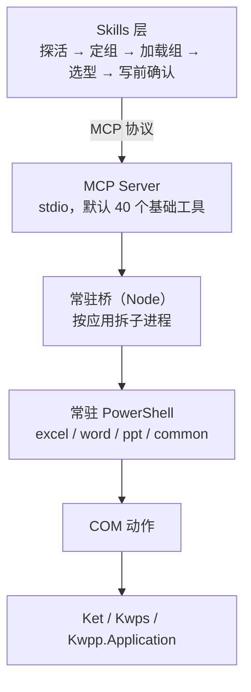

# WPS Office 多面手 MCP

**简体中文** | [English](README.en.md)

<!-- AUTO:badges:start -->
[](https://github.com/forkgo430/wps-multitool-mcp/actions/workflows/ci.yml) [](LICENSE) [](https://www.npmjs.com/package/wps-multitool-mcp) [](https://github.com/forkgo430/wps-multitool-mcp/releases) [](#能力一览) [](#安装)
<!-- AUTO:badges:end -->

> 让 AI 直接操控你正开着的 WPS 文字、表格、演示。
>
> 它不只会改，也能从零生成。空白页起一份带目录和图表的文稿；把表格里的数字变成图表与透视表，
> 再贴进演示；整篇换字体、套主题；导出成图片和 PDF。

| | 读 | 写 | 生成 | 排版 | 导出 |
|---|:--:|:--:|:--:|:--:|:--:|
| WPS 文字 | ✓ | ✓ | ✓ | ✓ | ✓ |
| WPS 表格 | ✓ | ✓ | ✓ | ✓ | ✓ |
| WPS 演示 | ✓ | ✓ | ✓ | ✓ | ✓ |

<sub>作者 / 维护者：**赢容** · [npm](https://www.npmjs.com/package/wps-multitool-mcp) · [Release](https://github.com/forkgo430/wps-multitool-mcp/releases)</sub>

## 30 秒上手

```powershell
npx -y wps-multitool-mcp
```

```json
{
  "mcpServers": {
    "wps-multitool-mcp": {
      "command": "npx",
      "args": ["-y", "wps-multitool-mcp"]
    }
  }
}
```

重启客户端，打开一个 WPS 文档，然后直接说：

> 把这份合同的金额段落加粗，并在末尾补一段风险提示

更多例子：

- "把这张表做成柱状图，导出成图片"
- "整份 PPT 统一成思源黑体，每页加上页码"
- "给这篇论文生成目录和交叉引用"

想要侧边面板（快照 / 撤销 / 状态），再装加载项：

```powershell
irm https://cdn.jsdelivr.net/gh/forkgo430/wps-multitool-mcp@main/scripts/install.ps1 | iex
```

> 在意安全？先把脚本下载下来用 `Get-FileHash` 和 Release 页公布的 SHA256 比对，再运行；
> 或把地址里的 `@main` 换成 `@v1.0.3` 锁定版本。

## 它能干什么

| 能做什么 | 怎么做到 |
|---|---|
| 从空白页做出一份成品 | 新建文稿、加页、写标题正文、套主题、加动画和切换、补页码，一条链走完 |
| 把表格数字变成汇报材料 | 表算完直接建图表或透视表，导出成图，贴进演示。省掉你复制粘贴那一步 |
| 演示里的结构件 | 时间轴、流程图、组织架构图、仪表盘、环形图、进度条、KPI 卡片、迷你图表、样式化表格，都有现成工具 |
| 整篇统一外观 | `beautify_all_slides` 套同一套风格，`unify_font` 统一字体，`auto_layout` 自动排版，`smart_distribute` 按间距分布 |
| 公文和论文的排版件 | 自动目录、书目索引、交叉引用、脚注、修订留痕、页眉页脚、按模板填字段 |
| 公式不止能写 | 能生成公式，也能诊断公式为什么报错。数组公式、透视表的建刷改查清都有 |
| 导出 | 演示单页出图，表格的图表和区域出图，格式转换，转 PDF |
| 批量执行带快照 | `wps_common_batch` 一次跑多步，碰上破坏性动作先存快照，事后能退回磁盘那一版 |

用起来省事的四个设计：

- **一句话定方向**：`wps_route_intent` 把"帮我做个汇报"映射到演示组，认不出来它会明说
- **用中文搜工具**：`wps_search_tools` 结果带 `notFor` 反例，近名工具靠它分
- **工具自带安全标签**：284 个都标明只读 / 会改动 / 可否重复执行
- **改名不砸旧调用**：旧名字自动解析到新工具，参数一并搬运

<!-- AUTO:tool-table:start -->
| 应用 | 工具数 | 主要能力 |
|------|--------|---------|
| Excel | 91 | 公式/数据/图表/透视表/工作表/格式/工作簿/行列/批注保护/图片导出 |
| Word | 69 | 格式/内容/文档管理/页眉页脚/批注/书签/表格/模板填写/学术排版/修订/索引/交叉引用 |
| PPT | 101 | 幻灯片/形状/图片/表格/美化/动画/图表/3D/数据可视化/图片导出 |
| 通用 | 26 | 保存/连接检测/文本选取/格式转换/工具组管理/意图路由/批量执行 |
| 内置 | 7（已计入上方各组） | 连接检查/万能方法调用/数据缓存 |
<!-- AUTO:tool-table:end -->

全部 284 个工具的完整清单（名称 / 是否需要确认 / 真机验证状态）见 **[TOOLS.md](TOOLS.md)**，
由注册表自动生成。旧名字调用会自动解析到新工具，参数一并搬运。

<details>
<summary><b>规模（由注册表实测生成）</b></summary>

<!-- AUTO:tool-stats:start -->
- **287 个工具**（7 个内置 + 280 个专业/组工具）；**默认只列 40 个**（基础档 ∩ 真机验证，按需加载 —— 口径与校验见 `scripts/manual/basic-tier-verify.js`）
- 分布（按工具组，内置计入对应组）：通用 26（含 core）/ Word 69 / Excel 91 / PPT 101
- 注解（实测）：只读 51 / 破坏性 35 / 非幂等 110，覆盖 287/287
<!-- AUTO:tool-stats:end -->

</details>

## 安装

<details>
<summary><b>环境要求</b></summary>

| 要求 | 说明 |
|------|------|
| Windows 10 / 11 | WPS 的 COM 自动化只在 Windows 可用 |
| WPS Office 2019+（实测 12.1） | 装哪个盘都行 |
| Node.js ≥ 18 | 构建与运行 MCP Server |
| 一个 MCP 客户端 | Claude Code / Cursor / Codex CLI / CodeBuddy / WorkBuddy / DeepSeek Harness（dsh）等 |

</details>

<details>
<summary><b>一键安装（MCP + 加载项 + skill）</b></summary>

```powershell
irm https://cdn.jsdelivr.net/gh/forkgo430/wps-multitool-mcp@main/scripts/install.ps1 | iex
```

自动完成：检查环境 → 拉取项目 → 装依赖并编译 → 部署 WPS 加载项 → 安装 skill → 打印 MCP 配置。
装完重启 WPS 和客户端即可。需要能访问 GitHub；否则用下面的手动安装。

</details>

<details>
<summary><b>手动安装</b></summary>

```bash
git clone https://github.com/forkgo430/wps-multitool-mcp.git
cd wps-multitool-mcp
powershell -ExecutionPolicy Bypass -File scripts/install.ps1
```

</details>

<details>
<summary><b>一键接入：自动写好 MCP 配置</b></summary>

```powershell
node wps-multitool-mcp/dist/index.js install
```

认这些客户端，各写各的原生格式：**CodeBuddy / WorkBuddy / Codex CLI / Claude Code / Cursor**，
另有 **DeepSeek Harness** 专用支持。只认已经装过的客户端；写配置前自动备份、写后回读校验、
失败自动还原。加 `--dry-run` 演练、`--print` 只打印不写盘。

</details>

## 它怎么工作



冷启动约 5 秒；之后每次调用是桥转发的往返 2~3 毫秒（不含 WPS 实际执行的动作本身）。
一个应用一个进程：文字那边卡死了，表格照样干活。

## 写错也退得回去

AI 会犯错，所以每一层都按"它一定会犯错"来设计：

| 防线 | 你得到什么 |
|---|---|
| **写前自动快照** | 破坏性 / 非幂等的写入动手前先存快照，配合操作日志，可退回磁盘上那一版 |
| **每个工具带安全标签** | 只读 / 会改动 / 可否重复执行，`tools/list` 里直接可读，客户端据此决定要不要先问你 |
| **失败告诉你能不能重试** | `[可重试]` 直接重发；`[勿重试·可能已执行一半]` 先读回来再定，不会把同一段内容写两遍 |
| **真机验证账本** | 每个工具都标真机验证状态（[TOOLS.md](TOOLS.md) 可查），默认档只收验证过的 |
| **多目标钉住** | 多文档任务显式指定"改哪一份"，不跟着窗口焦点走 |

## 侧边面板

`wps-multitool-addon/` 是一个装进 WPS 的任务窗格：侧边栏实时显示桥的状态，
外加 **保存 / 撤销 / 导出 PDF / 建快照 / 解除卡死** 五个动作按钮——注意它会真的改文档，
只读的只有状态查询接口。装不装面板都不影响 MCP，两者共用同一个桥。

## 在 DeepSeek Harness（dsh）里用

**一条命令，工具和技能一起装上**：

```sh
dsh plugin --profile <你的profile> add dsh-multitool
```

装上同时得到 40 个 WPS 工具和一份教 AI 正确使用顺序的技能，工具名前缀 `mcp__wpslocal__*`。

> ⚠️ 别装错包：npm 上另有一个 `dsh-wps`，那是金山文档**云文档**集成。本包操作的是
> 你电脑上正开着的 WPS 窗口，不联网、不需要 OAuth。两者可同时装。

## 隐私

- **文档内容不出本机**：没有遥测、没有崩溃上报、没有使用统计，`src/` 里没有任何出站请求
- 唯一的本地网络端点是桥的只读状态接口（`127.0.0.1:27731/status`，只给 WPS 任务窗格轮询）
- 快照按文档留在 `~/.wps-multitool-mcp/snapshots/`，等同文档副本；处理完敏感文档建议清空

完整威胁模型见 [SECURITY.md](SECURITY.md)。

## 已知限制

- **仅 Windows**：WPS 的 COM 自动化只在 Windows 可用（Linux 版在建设中，见下方路线）
- **需要 WPS 正开着**：它操控的是"活文档"，不是文件转换器
- **COM 写入不是事务**：改错了没有 Ctrl+Z——这正是默认快照存在的原因
- **默认 40 个工具**：其余按组加载，防止几百个工具塞满 AI 的上下文
- 部分工具尚未在真机验证过（清单里标注 `static`），用后请如实告知用户

## 故障排除

| 问题 | 解决方案 |
|------|---------|
| MCP 连接失败 | 确认 `dist/index.js` 存在，客户端路径正确 |
| WPS 未响应 | 重启 WPS，确认 `%APPDATA%\kingsoft\wps\jsaddons\wps-claude-addon_` 存在 |
| "arguments error" | 重跑 `scripts/install.ps1`，重启 WPS |
| 一键安装卡住 | 访问不了 GitHub，改用「手动安装」 |
| 其他问题 | [提 issue](https://github.com/forkgo430/wps-multitool-mcp/issues) |

## 路线

- **Linux / macOS**：平台自动识别与加载项通道骨架已落地，WPS JSAPI 全量覆盖率已实测
  （296 动作：支持 199 / 可适配 45+），动作层实现中。详见 `docs/agents/linux/`。
- **多应用批量与自动化检查**持续加细；欢迎 [提 issue](https://github.com/forkgo430/wps-multitool-mcp/issues) 点名你最想要的场景。

## 许可

MIT
